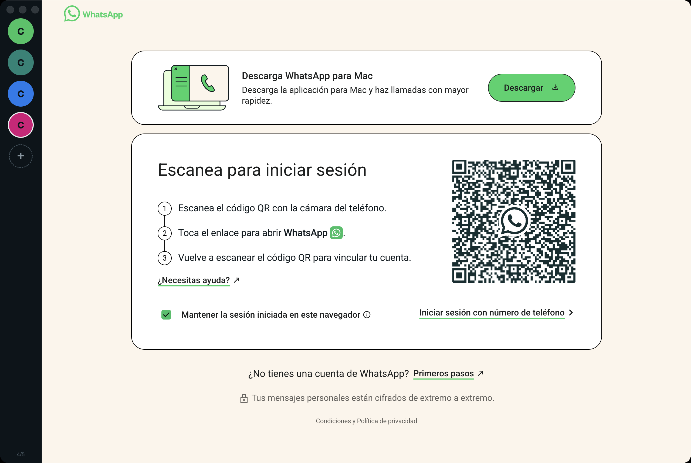

# WA5

**Hasta cinco cuentas de WhatsApp Web al mismo tiempo, en una sola app de macOS.**

Cada cuenta corre en su propia sesión de Chromium —cookies, `localStorage` e `IndexedDB`
separados— así que ningún número ve ni pisa la sesión de otro. Cambias de cuenta con un
clic o con `⌘1` … `⌘5`.

> Proyecto independiente. No está afiliado, patrocinado ni respaldado por WhatsApp LLC ni
> por Meta Platforms, Inc. «WhatsApp» es una marca registrada de sus titulares.



---

## Qué hace

- **Cinco cuentas simultáneas**, cada una con login independiente y persistente.
- **Aislamiento real de sesión**: cada cuenta vive en una partición `persist:wa-<id>`
  distinta. Nada de perfiles de navegador ni ventanas sueltas.
- **Contraseña de entrada** con perfil fijo y **Touch ID** opcional (ver más abajo).
- **Cambio instantáneo** desde la barra lateral o con `⌘1` … `⌘5`.
- **Contador de no leídos** por cuenta y suma total en el badge del Dock.
- **Notificación nativa** cuando entra un mensaje a una cuenta que no está a la vista.
- **Servidor de control local** opcional para que un agente lea y deje borradores.
- **Cerrar sesión** o **eliminar** una cuenta borrando de verdad sus datos locales.
- **Zoom independiente** por cuenta (`⌘+`, `⌘-`, `⌘0`).
- Cero telemetría: WA5 no manda nada a ningún servidor. Todo vive en tu Mac.

## Lo que no hace

- No crea cuentas de WhatsApp: usas números que ya tienes.
- No evade las reglas de WhatsApp; la app carga `web.whatsapp.com` tal cual.
- No funciona sin internet ni sin el teléfono vinculado, igual que WhatsApp Web.
- **No envía mensajes por su cuenta.** El servidor de control solo escribe borradores.

## Instalar

Requiere macOS 11 o superior y Node 18 o superior.

```bash
git clone https://github.com/waltgarcia/wa5.git
cd wa5
npm install
npm start
```

### Generar el .app

```bash
npm run empaquetar      # deja dist/WA5-darwin-arm64/WA5.app
cp -R dist/WA5-darwin-arm64/WA5.app /Applications/
./reinstalar.sh         # o el script, que hace lo anterior y la abre
```

La primera vez que abras el `.app` sin firma, macOS pedirá confirmación:
clic derecho sobre el ícono → **Abrir**.

## Contraseña de entrada y Touch ID

En el primer arranque la app pide dos cosas:

1. **Nombre del perfil** — se guarda una vez y ya no se pregunta más.
2. **Contraseña local** — mínimo 6 caracteres.

Sin eso no se crea la ventana de WhatsApp: no hay conversaciones detrás de la puerta.
La contraseña se guarda como hash **scrypt** (sal aleatoria de 16 bytes, 16 384
iteraciones) en `~/Library/Application Support/WA5/acceso.json` con permisos `600`.
El texto de la contraseña nunca se escribe en disco.

**Solo se pide una vez**: mientras uses la app no vuelve a aparecer. Reaparece cuando
pasan **5 minutos sin tocar nada** (ni mouse, ni teclado, ni cambio de cuenta), y
también si cierras la app y la vuelves a abrir después de ese rato. El plazo se cuenta
desde tu último gesto real, se mide dentro de cada cuenta de WhatsApp y en la barra
lateral, y la marca que lo recuerda va firmada con el hash, así que editarla a mano no
sirve para saltarse la contraseña.

En Macs con sensor, aparece además **Usar Touch ID**, que desbloquea con la huella.
La contraseña sigue funcionando como respaldo: Touch ID depende de que la huella esté
configurada en esa Mac y de que el sensor responda.

`⌘L` bloquea la app al instante: se destruyen las vistas de WhatsApp y vuelve la
pantalla de contraseña.

Tras 5 fallos seguidos la app espera 30 segundos antes de aceptar otro intento.

> Si olvidas la contraseña, borra `acceso.json` y vuelve a configurarla. Las sesiones de
> WhatsApp no se pierden, porque viven en otra carpeta.

## Instalar y usar las cuentas

1. Abre la app, configura el acceso y entra. Se crea sola la cuenta **Personal**.
2. En el teléfono: WhatsApp → **Dispositivos vinculados** → *Vincular un dispositivo*.
3. Escanea el QR. Repite con el **+** de la barra lateral para cada cuenta nueva.
4. Clic derecho sobre un círculo de la barra: renombrar, recargar, reparar, cerrar
   sesión, zoom o eliminar cuenta.

| Atajo | Acción |
|---|---|
| `⌘1` … `⌘5` | Ir a la cuenta 1–5 |
| `⌘⇧N` | Agregar cuenta |
| `⌘R` | Recargar la cuenta activa |
| `⌘L` | Bloquear la app |
| `⌘+` / `⌘-` / `⌘0` | Zoom de la cuenta activa |

### Si una cuenta se queda en «Cargando tus chats…»

Es la caché o el service worker de esa partición, no tu sesión. Clic derecho sobre la
cuenta → **Reparar si se queda cargando**. Borra caché y service workers pero conserva
cookies e `IndexedDB`, así que **no hay que volver a escanear el QR**.

## Control local para agentes (opcional)

La app levanta un servidor HTTP en `127.0.0.1:5077` que solo acepta peticiones de la
misma Mac y exige un token que se genera la primera vez en
`~/Library/Application Support/WA5/control.json` (permisos `600`, fuera del repo).

| Ruta | Qué hace |
|---|---|
| `GET /estado` | cuentas, no leídos y si la app está desbloqueada |
| `GET /pendientes?cuenta=X` | chats con mensajes sin leer |
| `GET /leer?cuenta=X&chat=Y&n=20` | últimos mensajes de una conversación |
| `POST /borrador` | escribe un texto en la caja, **sin enviarlo** |
| `GET /diag` | diagnóstico de la vista (para depurar selectores) |

Con la app bloqueada el servidor responde `423`: el agente no ve nada hasta que
desbloquees.

### Servidor MCP

`mcp/servidor.mjs` expone el control como herramientas MCP (`wa5_cuentas`,
`wa5_pendientes`, `wa5_leer`, `wa5_borrador`). Para usarlo con un cliente MCP, regístralo
como servidor por stdio:

```json
{
  "mcpServers": {
    "wa5": {
      "command": "node",
      "args": ["/ruta/absoluta/a/wa5/mcp/servidor.mjs"]
    }
  }
}
```

**No existe herramienta de envío.** `wa5_borrador` deja el texto escrito y el chat
abierto para que la persona lo revise y dé Enter. Automatizar el envío va contra los
términos de WhatsApp y puede costarte el número; dejarlo fuera es deliberado.

### Límites que conviene saber

- Leer una conversación la **marca como leída** en WhatsApp: hay que abrirla.
- Los selectores dependen del DOM de WhatsApp Web. Cuando Meta los cambie, hay que
  ajustar unas líneas de `control.js` (`/diag` ayuda a encontrarlos).
- El servidor de control solo responde con la app abierta y desbloqueada.
- Para leer una cuenta, la app la trae al frente: es visible que el agente la consultó.

## Cómo funciona

```
main.js                  proceso principal: ventana, cuentas y sesiones
 ├─ BrowserWindow        dibuja solo la barra lateral (renderer/)
 ├─ WebContentsView ×N   una vista web por cuenta, aislada por partición
 └─ session.fromPartition('persist:wa-<id>')   cookies + storage por número
seguridad.js             contraseña scrypt y verificación con límite de intentos
control.js               servidor HTTP local para agentes
mcp/servidor.mjs         servidor MCP por stdio (no va dentro del .app)
preload.js               puente IPC con contextIsolation (sin nodeIntegration)
renderer/                barra lateral y pantalla de acceso
```

Las cuentas se guardan en `~/Library/Application Support/WA5/cuentas.json`.
Los datos de sesión de cada cuenta quedan en `~/Library/Application Support/WA5/Partitions/wa-<id>/`.
Borrar ese directorio equivale a cerrar sesión en todas las cuentas.

## Por qué no un navegador con perfiles

Funciona, pero son ventanas sueltas sin barra común, sin badge unificado y con un
`user-data-dir` por cuenta que hay que administrar a mano. WA5 junta todo en una
ventana y usa las particiones de sesión de Electron, que es el mecanismo que el propio
Chromium usa para aislar perfiles.

## Estado

macOS, Apple Silicon e Intel. En Linux y Windows debería funcionar sin cambios, pero no
está probado; los PR son bienvenidos.

## Licencia

MIT — ver [LICENSE](LICENSE).
